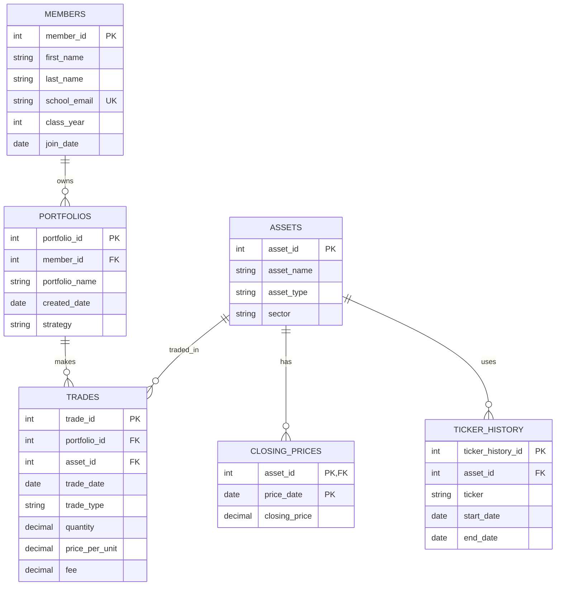

# Database Project — Babson Investment Club

## 1. The Scenario

Scenario B: Babson Investment Club

The Babson Investment Club manages paper investment portfolios for students. The club currently tracks members, portfolios, assets, trades, and closing prices using spreadsheets. The goal is to create a database that organizes this information and allows the club to track investments, calculate portfolio holdings, and analyze trading activity.

## 2. The ERD 
Every table, its columns, its primary key and its foreign keys, and every relationship with both of its ends marked, as a mermaid erDiagram. Put it between a line `mermaid and a line , as below, and VS Code's preview and GitHub both show it as a diagram. Chapter A of the SQL handbook, §5, shows how to read one.

## 3. What One Row Means
One sentence for each table, in the way Northwind's would read: "One row of orders is one order placed by one customer."

- MEMBERS: Each row represents one student who belongs to the Babson Investment Club, including their name, email, class year, and join date.

- PORTFOLIOS: Each row represents one investment portfolio owned by a club member. Note that a member can own multiple portfolios.

- ASSETS: Each row represents one investment asset that the club follows, such as a stock, ETF, or cryptocurrency.

- TICKER_HISTORY: Each row represents one ticker symbol assigned to an asset during a specific period. This allows the database to track ticker changes without creating a new asset since both tickers reference one same asset_id.

- TRADES: Each row represents one buy or sell transaction made by a portfolio for a particular asset on a specific date.

- CLOSING_PRICES: Each row represents the closing price of one asset on one specific date, allowing the club to maintain historical pricing information.

## 4. Design Choices
Four short answers, in your own words. Which key you chose where the business already had one, such as an email or a ticker, and why. Which relationships are optional, and what in the scenario tells you so. Which of the scenario's rules your tables cannot hold, and how you will check it instead. And one thing your agent proposed for the design that you changed or did not take, and why; if you designed it alone, one thing you checked in the ERD your agent drew.

First off, I used unique_IDs as primary keys for members, portfolios, assets, and trades. The reason for this decision is that although members have unique emails and assets have individual tickers, these can change. By making a unique_ID correlated to each, a change in email or ticker wont affect their relationships.

Members can have multiple portoflios or none at all, since hte scenario specifies that some members may not own any portfoliios. Moreover, a portfolio may have no trades yet, and an asset can exist without it have been traded. Therefore, these relationships are optional since they can exist without having any activity related to them. 

The database cannot use a simple CHECK constraint to prevent a portfolio from selling more shares than it owns because this depends on previous transactions, not one single row. To do so, the database needs to know how many shares the portfolio owned before the sale.Therefore, I will use a SQL query to calculate the running balance of shares after each trade and flag any transactions where the balance becomes negative.

I checked how the agent handled ticker changes in the ERD. Instead of using tickers as primary keys for assets, the design uses a separate TICKER_HISTORY table. I kept this approach because a company can change its ticker which doesn't mean it is becoming a completely different asset, and the database should be able to preserve its complete trading history, even under a new ticker. 
